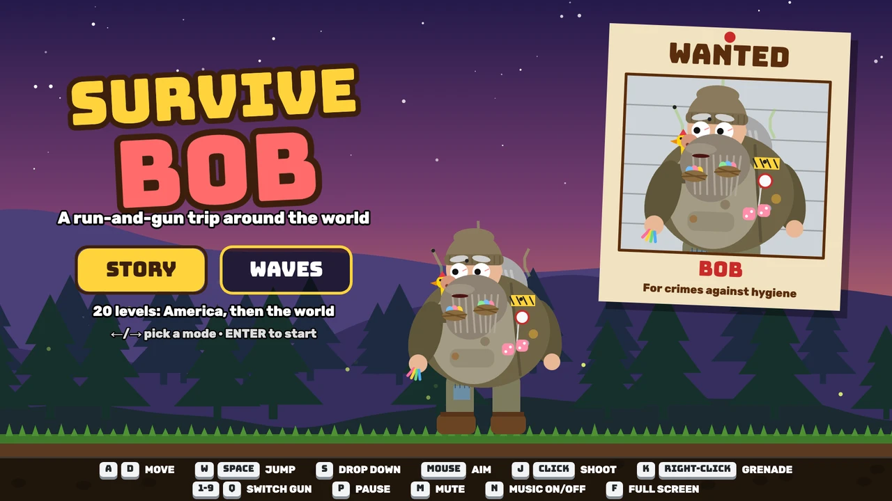
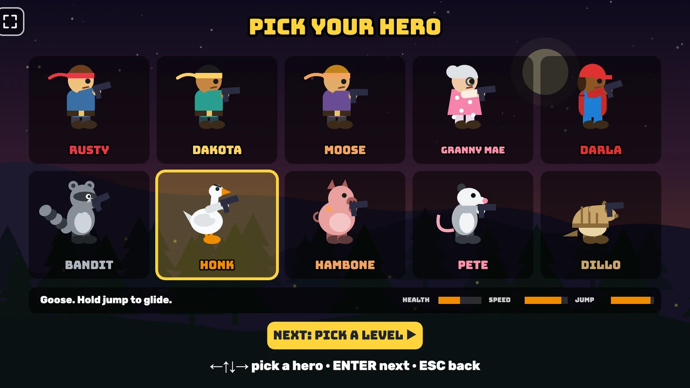
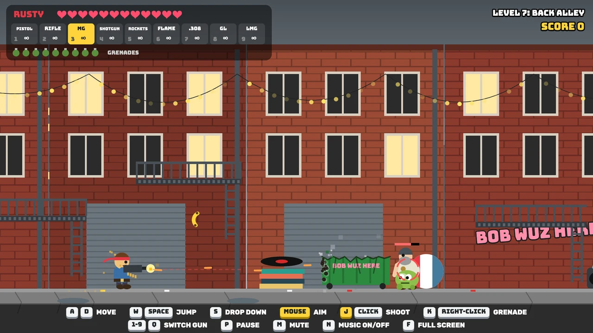
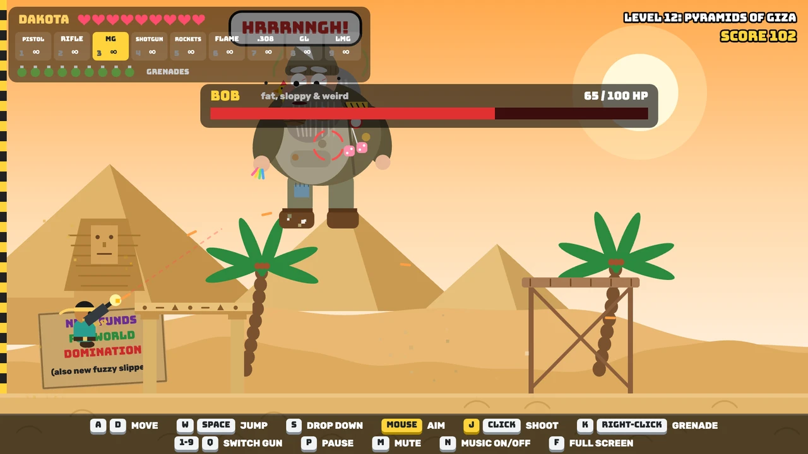
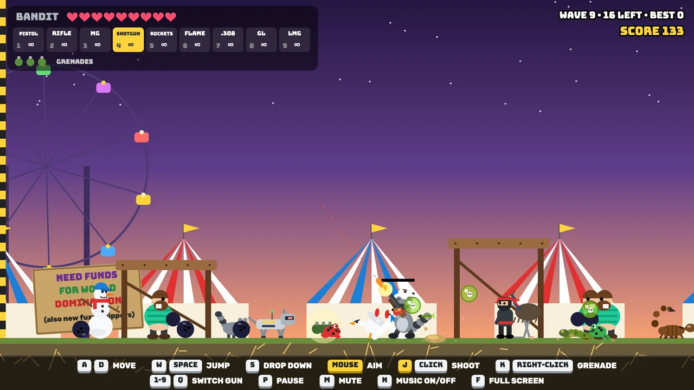
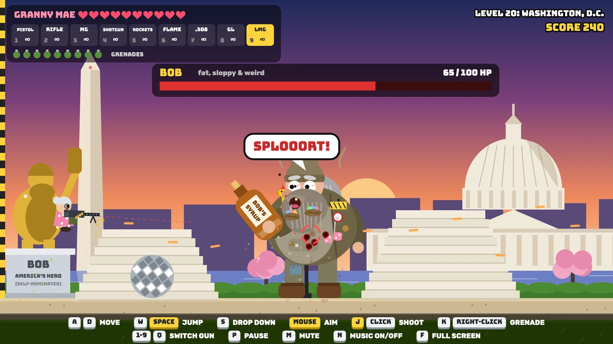

# Survive Bob

## [▶ Play Survive Bob now](https://marknakasone85.github.io/survive-bob/)

Free in your browser, on computers, phones and tablets. Nothing to install. Plug in a game controller if you like. On a phone, use **Add to Home Screen** and it opens full screen, like an app.

[](https://marknakasone85.github.io/survive-bob/)

A run-and-gun browser game. Pick a hero and chase Bob, a fat, sloppy villain who makes weird noises, across 20 levels: 10 across America, then the world (Tokyo, Giza, Petra, the Amazon, the Outback, Antarctica, Everest, the Colosseum, Area 51), ending in Washington, D.C. There's also an endless Waves mode.

Plain HTML5 canvas and JavaScript. No build step, no libraries.

## Screenshots

<p>
  
  
</p>

*The title screen, and the ten heroes you can play, from Rusty and Granny Mae to a raccoon, a goose, a hog and an armadillo.*

<p>
  
  
</p>

*Shooting a dumpster to bits to get at the goons hiding behind it. Bob at the Pyramids of Giza.*

<p>
  
  
</p>

*Waves mode sends enemies from every level at you. The final showdown with Bob in Washington, D.C.*

## Play it locally

```bash
python3 -m http.server 8765
```

Then open http://localhost:8765.

## Controls

| Action | Keyboard | Mouse / touch | Game controller |
|---|---|---|---|
| Move | ← → or A D | on-screen ◀ ▶ | left stick or d-pad |
| Jump (hold for higher) | Space, W or ↑ | JUMP | A |
| Drop through a platform | S or ↓ | ▼ | down |
| Aim | | mouse | right stick |
| Shoot | J | click / FIRE | X or right trigger |
| Grenade | K | right-click / 💣 | B or left trigger |
| Switch gun | Q or 1–9 | GUN | Y or RB (LB goes back) |
| Pause and pick any level | P or Esc | II | Start |
| Mute / music on-off | M / N | | |
| Full screen | F | corner button on the menus | |

Shooting auto-aims at the closest enemy in front of you unless you aim yourself. A controller works in the menus too (A picks, B goes back), and the help on screen switches to controller buttons. Button names are Xbox-style; on PlayStation, A is ✕, B is ◯, X is ▢ and Y is △.

Crates, barrels, cars and rocks are cover, and it works both ways. It stops your shots, so enemies can hide behind it, and it stops the junk they throw, so you can too. Every hit chips it until it breaks into rubble. After that, shots go straight through and enemies can walk past. Grenades and rockets wreck cover fast, and the .308 battle rifle punches right through it.

## Code map

- `index.html`: the page, the canvas, the touch buttons and the full-screen button, plus the link-preview tags
- `style.css`: the page layout and the fonts
- `manifest.webmanifest`, `assets/icons/`: name and icons for Add to Home Screen
- `assets/screenshot.png`, `assets/screens/`: the pictures in this README (the game itself doesn't load them)
- `js/game.js`: game states, menus, the level picker, the HUD, controllers, full screen and the main loop
- `js/levels*.js`, `js/world1.js`, `js/world2.js`, `js/dc.js`: levels, backgrounds and the enemies for each world
- `js/props.js`: scenery, pickups, and cover that can be shot to bits
- `js/bob.js`: Bob the boss and his death scene
- `js/enemies*.js`, `js/player.js`, `js/heroes.js`, `js/waves.js`: enemies, heroes, guns and Waves mode
- `js/audio.js`, `js/music.js`: sound effects and the music, all made in code

## Notices

**Fiction.** Survive Bob is a cartoon comedy. Bob and every other character are made up. Any resemblance to real people is a coincidence.

**Content.** Cartoon violence: cartoon guns, explosions and some cartoon blood, mostly in the final level.

**Privacy.** The game collects no personal data. There are no accounts, ads, analytics, trackers or cookies, and it never sends anything anywhere. It loads only its own files (fonts included). The one thing it saves is your best Waves score, kept in your own browser's local storage, which you can clear at any time. The site is hosted on GitHub Pages, and GitHub may log visitors' IP addresses for security: see [GitHub's privacy statement](https://docs.github.com/en/site-policy/privacy-policies/github-general-privacy-statement).

**Credits.**
- Fonts: [Bungee](https://github.com/djrrb/Bungee) by David Jonathan Ross and [Rubik](https://github.com/googlefonts/rubik) by Hubert & Fischer, both under the SIL Open Font License 1.1 (see `assets/fonts/`).
- All art, music and sound effects are made in code.
- Bob's look started from a concept picture made with Google Gemini.
- Written with help from Claude (Anthropic).

**Copyright.** © 2026 Mark A. Nakasone. All rights reserved. You're welcome to play it and read the code, but please ask before reusing it. The fonts keep their own open licence (see `assets/fonts/`).

This game is provided "as is", without warranty of any kind. In no event shall the author be liable for any claim, damages or other liability arising from its use.
