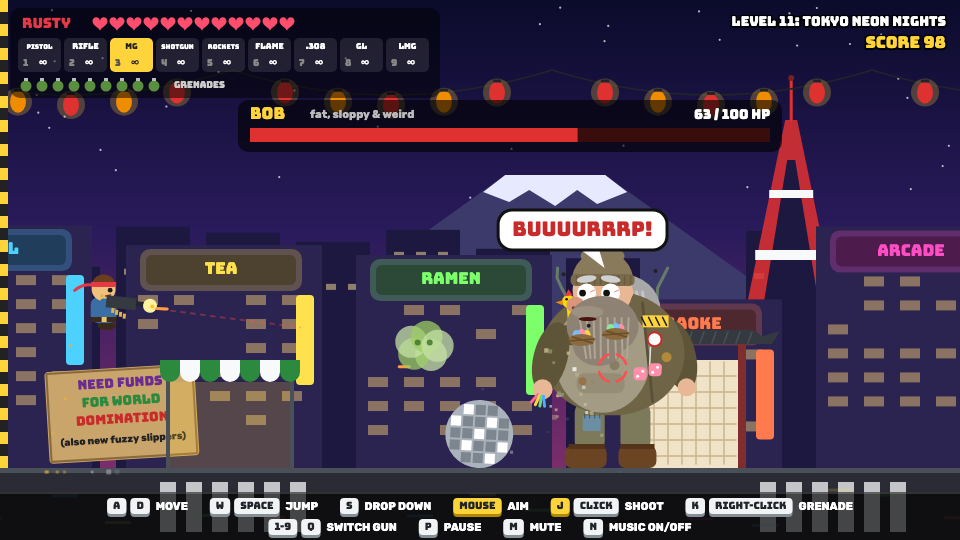

# Survive Bob

## [▶ Play Survive Bob now](https://marknakasone85.github.io/survive-bob/)

Free in your browser, on computers, phones and tablets. Nothing to install.

[](https://marknakasone85.github.io/survive-bob/)

A run-and-gun browser game. Pick a hero and chase Bob, a fat, sloppy villain who makes weird noises, across 20 levels: 10 across America, then the world (Tokyo, Giza, Petra, the Amazon, the Outback, Antarctica, Everest, the Colosseum, Area 51), ending in Washington, D.C. There's also an endless Waves mode.

Plain HTML5 canvas and JavaScript. No build step, no libraries.

## Play it locally

```bash
python3 -m http.server 8765
```

Then open http://localhost:8765.

## Controls

| Action | Keyboard | Mouse / touch |
|---|---|---|
| Move | ← → or A D | on-screen ◀ ▶ |
| Jump (hold for higher) | Space, W or ↑ | JUMP |
| Drop through a platform | S or ↓ | ▼ |
| Aim | | mouse |
| Shoot | J | click / FIRE |
| Grenade | K | right-click / 💣 |
| Switch gun | Q or 1–9 | GUN |
| Pause and pick any level | P or Esc | II |
| Mute / music on-off | M / N | |

## Code map

- `index.html`: the page, the canvas and the touch buttons
- `js/game.js`: game states, menus, the level picker, the HUD and the main loop
- `js/levels*.js`, `js/world1.js`, `js/world2.js`, `js/dc.js`: levels, backgrounds and the enemies for each world
- `js/bob.js`: Bob the boss and his death scene
- `js/enemies*.js`, `js/player.js`, `js/heroes.js`, `js/waves.js`: enemies, heroes, guns and Waves mode
- `js/audio.js`, `js/music.js`: sound effects and the music, all made in code

## Notices

**Fiction.** Survive Bob is a cartoon comedy. Bob and every other character are made up. Any resemblance to real people is a coincidence.

**Content.** Cartoon violence: cartoon guns, explosions and some cartoon blood, mostly in the final level.

**Privacy.** The game collects no personal data. There are no accounts, ads, analytics, trackers or cookies, and it never sends anything anywhere. It loads only its own files (fonts included). The one thing it saves is your best Waves score, kept in your own browser's local storage, which you can clear at any time. The site is hosted on GitHub Pages, and GitHub may log visitors' IP addresses for security: see [GitHub's privacy statement](https://docs.github.com/en/site-policy/privacy-policies/github-general-privacy-statement).

**Credits.**
- Fonts: [Bungee](https://github.com/djrrb/Bungee) by David Jonathan Ross and [Rubik](https://github.com/googlefonts/rubik) by Hubert & Fischer, both under the SIL Open Font License 1.1 (see `assets/fonts/`).
- All art, music and sound effects are made in code.
- Bob's look started from a concept picture made with Google Gemini.
- Written with help from Claude (Anthropic).

**Copyright.** © 2026 Mark A. Nakasone. All rights reserved. You're welcome to play it and read the code, but please ask before reusing it. The fonts keep their own open licence (see `assets/fonts/`).

This game is provided "as is", without warranty of any kind. In no event shall the author be liable for any claim, damages or other liability arising from its use.
